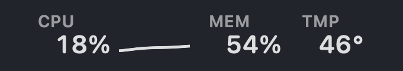

<p align="center">
  
</p>

<h1 align="center">MacHelper</h1>

<p align="center">
  <b>ネイティブ macOS システムモニタ、ファン制御、クリーナー、ディスク分析 & AI 対応 CLI — ローカルファースト、オープンソース、Apple Silicon と Intel 対応。</b>
</p>

<p align="center">
  <a href="https://github.com/smile-minecraft/MacHelper/releases/latest"></a>
  
  
  <a href="LICENSE"></a>
  <a href="https://smile-minecraft.github.io/MacHelper/"></a>
</p>

<p align="center">
  <a href="README.md">English</a> ·
  <a href="README.zh-Hant.md">繁體中文</a> ·
  <a href="README.zh-Hans.md">简体中文</a> ·
  <b>日本語</b> ·
  <a href="README.ko.md">한국어</a> ·
  <a href="README.es.md">Español</a>
</p>

<p align="center">
  <a href="#machelper-が選ばれる理由">選ばれる理由</a> ·
  <a href="#インストール">インストール</a> ·
  <a href="#機能">機能</a> ·
  <a href="#プライバシーとテレメトリ">プライバシー</a> ·
  <a href="#初回起動">初回起動</a> ·
  <a href="#コマンドライン">CLI</a> ·
  <a href="#ai-エージェントで使う">AI エージェント</a> ·
  <a href="#よくある質問">FAQ</a> ·
  <a href="#ソースからのビルド">ビルド</a>
</p>

<p align="center">
  
</p>

<p align="center">
  
</p>

---

MacHelper は、macOS 14 以降の Apple Silicon および Intel Mac 向けにネイティブ Swift で開発された、無料・MIT ライセンスのメニューバー App およびコマンドラインツールです。**システムモニタ**（CPU、GPU、メモリ、温度、ファン、消費電力、バッテリー、ディスク、ネットワーク）、**ファンコントロール**、**キャッシュとジャンクのクリーン**、**ディスク容量の分析**、**App のアンインストール**を 1 つの軽量 App に統合しています。

さらに、`--json` 出力に対応した `machelper` CLI、個人情報マスク済みのワンショット診断レポート（`machelper report --json`）、Claude Code・Codex・OpenCode などの AI コーディングアシスタント向けスキルを同梱。常にまずプレビューを表示し、削除前には必ず確認を求めます。

## MacHelper が選ばれる理由

5 つの有料ユーティリティを使い分ける代わりに、MacHelper ならネイティブ App 1 つで完結します。

| 機能領域 | 置き換えるツール | MacHelper のアプローチ |
|---|---|---|
| **システム & メニューバー監視** | iStat Menus | ネイティブ SwiftUI/AppKit センサー、P/E コア分離、1時間/24時間/7日間履歴、8 種の表示スタイル |
| **ファン回転数とカーブ** | Macs Fan Control | 固定 RPM・温度カーブ、「上げるだけ」モード、実行中の App や電源ごとの自動プロファイル |
| **クリーン & メンテナンス** | CleanMyMac | 宣言型ルール、デフォルトでプレビューのみ、中・高リスクはゴミ箱へ移動、保護パス厳守 |
| **ディスク容量分析** | DaisyDisk | 高速 `getattrlistbulk` サンバースト & ツリーマップ、APFS クローン認識の重複検出、増加追跡 |
| **App アンインストール** | AppCleaner | バンドル ID・内蔵ヘルパー・コンテナ・launchd・Homebrew zap 照合 + 孤立ファイル掃除 |
| **AI エージェント連携** | *MacHelper 独自* | `machelper report --json` 匿名化診断レポート、`--yes` 安全ゲート、ビルトインスキル |

> **無料 · オープンソース (MIT) · ネイティブ Swift · Apple Silicon & Intel · デフォルトでローカルファースト**

## インストール

```sh
brew install --cask smile-minecraft/tap/machelper
```

または [Releases](https://github.com/smile-minecraft/MacHelper/releases/latest) から `MacHelper-<バージョン>.dmg` をダウンロードし、**MacHelper** を「アプリケーション」フォルダへドラッグしてください。すべてのリリースは Developer ID で署名され Apple の公証を受けており、チェックサムは各リリースページの `SHA256SUMS.txt` に公開されています。概要や最新リリースの見どころは [MacHelper Web サイト](https://smile-minecraft.github.io/MacHelper/) でも確認できます。

**自動アップデート：** バックグラウンドで新バージョンを確認し、見つかった場合のみサイドバー・メニューバーパネル・設定に **x.y.z にアップデート** ボタンを表示します。クリックするまで勝手にインストールされることはありません。リリースノートは選択中の App 言語で表示されます。

## 機能

<table>
  <tr>
    <td width="50%" valign="top">
      <h3>システムモニタ</h3>
      
      <p>CPU（高性能コアと高効率コア）、GPU、メモリプレッシャー、温度、ファン、電力、バッテリー、ディスクおよびネットワークのスループットをリアルタイムグラフと 1 分ごとの履歴（1 時間、24 時間、7 日間）で可視化。メモリと温度には警告ラインを表示できます。メニューバー項目はテキスト、折れ線、縦棒、バー、リング、ブロック、ヒートピル、2 本線から選べます。</p>
    </td>
    <td width="50%" valign="top">
      <h3>ヘルスチェック</h3>
      
      <p>直近数時間のシステム履歴、空き容量、バックグラウンド項目からヘルススコアを算出し、低下の理由と対処法を案内します。Gatekeeper、FileVault、ファイアウォール、システム整合性保護（SIP）、自動セキュリティアップデート、XProtect の読み取り専用チェックも含まれます。</p>
    </td>
  </tr>
  <tr>
    <td colspan="2" valign="top">
      <h3>ディスク分析</h3>
      
      <p>インタラクティブなサンバーストとツリーマップ（どのフォルダもクリックで即ドリルダウン）、種類・期間フィルター付きの巨大ファイル一覧、APFS クローンやハードリンクを正しく区別する重複検出、前回スキャンからの容量変化、長期未使用の大容量ファイルや肥大化フォルダの整理提案。項目をコレクターへドラッグしてまとめてゴミ箱へ送れます。</p>
    </td>
  </tr>
</table>

| カテゴリ | 主な機能 |
|---|---|
| **ファン制御** | 自動、固定回転数、温度カーブ（静音・バランス・パフォーマンス・カスタム）、「上げるだけ」モード、安全上限、実行中の App や電源ソースに応じた自動プロファイル切り替え。 |
| **ワンクリック最適化** | プレビュー付きの宣言型クリーンルール。低リスクのキャッシュは直接削除し、中・高リスクの項目はゴミ箱へ移動します。保護パス、クリーン対象外リスト、操作ログ、メンテナンス、ビルド成果物削除、スケジュール自動クリーンに対応。 |
| **App アンインストール** | バンドル ID、内蔵ヘルパー、エンタイトルメント、コンテナ情報、`launchd` 所有者、Homebrew zap リスト、App 別ルールから関連ファイルを特定。名前のみの一致は確認フラグを付け、削除済み App の残りも検出します。 |
| **起動項目** | 自分の Launch Agent の無効化・有効化・削除に加え、全ユーザ用 Agent とシステム Daemon を一覧表示し、所属 App や壊れた項目を明示します。 |
| **Homebrew アップデート** | Homebrew でインストールした App や Cask を MacHelper 上から確認・更新できます。 |
| **通知** | CPU 高温、メモリプレッシャー危険域、ディスク空き容量不足を通知します。 |
| **オプションの履歴** | プロセス・センサー・コアの履歴はデフォルトでオフ。プロセス履歴は名前・CPU・メモリのみを保存し（パス・引数・ユーザ名は非保存）、1〜30 日間保持できます。 |
| **スライム** | Mac の状態に合わせて色（青・黄・赤）が変化し、クリック・ホバー・ドラッグや発熱・クリーン完了などのイベントに反応します。「視差効果を減らす」と VoiceOver に対応。 |
| **テーマとマテリアル** | ライト／ダーク／システム連動モード、ソリッド／フロスト／Liquid Glass の表面マテリアル、Instrument と Pixel Retro プリセット、VS Code テーマのインポート、コントラスト検証済みの視認性を備えています。 |
| **言語** | 英語、繁体字中国語、簡体字中国語、日本語、韓国語、スペイン語に対応。**設定 → 一般 → 言語** で macOS とは独立して指定できます。 |

## プライバシーとテレメトリ

- **デフォルトでローカルファースト。** MacHelper が測定・スキャン・保存するすべてのデータは Mac の内部にとどまります。アカウント登録もクラウド同期もバックグラウンド追跡もありません。アップデートの確認を除き、明示的にオプトインしない限り外部へ通信しません。
- **オプショナルなテレメトリ（デフォルトはオフ）。** **設定 → 一般 → プライバシーと診断** から、厳密に匿名化された利用回数と粗粒度のパフォーマンス診断（App バージョン、macOS バージョン、チップファミリー、匿名化カウンター）の共有を有効にできます。
- **機密データは一切収集しません。** ファイルパス、プロセス名、ディスク内容、ホスト名、個人識別子は絶対に収集しません。送信前に設定画面で実際の JSON ペイロードをプレビューでき、いつでもオフに戻せます。オフにすると匿名 ID と送信待ちキューが即座に消去されます。

## 初回起動

MacHelper は 6 ステップの **ようこそガイド**（**ヘルプ → ようこそガイド…** からいつでも再表示可能）を開き、設定や任意の **フルディスクアクセス**、**Helper**、**AI エージェントスキル** を案内します。任意の権限を許可しなくてもほかの機能はすべて動作します：

1. **フルディスクアクセス**を有効にすると、メールのダウンロードや他 App のキャッシュなど保護された領域も分析・クリーンできるようになります。**システム設定 → プライバシーとセキュリティ → フルディスクアクセス** で MacHelper をオンにすると、ようこそガイドが自動で検知します。システム整合性保護（SIP）下のフォルダはオンにしても読み取れず、ディスク分析では別枠で表示されます。
2. **Helper** はファン制御、システムのキャッシュ／ログのクリーン、システムバックグラウンド項目、システムプロセス使用量の取得を担う軽量な root デーモンです。案内に従ってインストールし、**システム設定 → 一般 → ログイン項目と機能拡張** で許可すると応答を確認します。呼び出し元のコード署名はすべて検証されます。オフのあいだはサイドバー下部の **Helper を設定…** からいつでも設定を再表示できます。
3. **AI エージェントスキル** は検出されたエージェント（Claude Code や Codex など）向けにガイドから直接インストールでき、既存のカスタム `SKILL.md` を上書きすることはありません。

## コマンドライン

App には `machelper` CLI が同梱されています（Homebrew 経由なら自動でパスが通ります）。どのコマンドもデフォルトでプレビューのみを行い、`--json` 出力に対応しているためスクリプトや AI エージェントに最適です。概要は `machelper guide`、個別オプションは `machelper <コマンド> --help` で確認できます。

```sh
machelper report --json                 # 個人情報マスク済みのフルシステム診断レポート
machelper status --json                 # リアルタイムのハードウェア・温度・ファン・バッテリー状態
machelper clean                         # クリーン対象のプレビュー
machelper clean --max-risk low --yes    # 低リスク項目のみをクリーン
```

## AI エージェントで使う

Claude Code、Codex、OpenCode などの AI アシスタントに「Mac が重い・熱い原因を調べて」「空き容量を増やして」「`node_modules` や Xcode の残りを掃除して」「App を完全に消して」「ログイン項目を点検して」と頼むとき、`machelper` は安全で構造化されたインターフェースを提供します。

- **ワンショットの匿名化診断レポート（`machelper report`）。** `machelper report --json`（または `machelper report --format markdown`）を実行すると、ハードウェア、ライブメトリクス、ヘルススコア、ストレージ、セキュリティ監査、クリーンアッププレビュー、起動項目を 1 回の呼び出しで取得できます。ユーザ名、ホームパス、ホスト名、IP、MAC アドレスはデフォルトでマスクされ、JSON 出力には構造化された `suggestedActions` と `availableTools` が含まれるため、AI エージェントが安全に後続コマンドを連鎖できます。
- **デフォルトで安全。** 変更を伴うコマンドはすべてプレビューのみを行い、`--yes` を付けない限り何も変更しません。削除項目は `--permanent` を付けない限りゴミ箱へ移動し、保護パス（キーチェーン、メール、写真、`~/.ssh`、`~/Documents` など）は削除できません。
- **機械可読。** すべての主要コマンドが `--json`、`schemaVersion` フィールド、安定した終了コードに対応し、`machelper --experimental-dump-help` でコマンドツリー全体を JSON 取得できます。
- **ビルトインエージェントスキル。** `machelper skill install claude` または `machelper skill install codex`（設定画面からも実行可）により、まず調査・プレビューし実行前に同意を求める `SKILL.md` をインストールします。

```sh
brew install --cask smile-minecraft/tap/machelper
machelper guide                          # エージェントが最初に読むべきガイド
machelper report --json                  # 匿名化済みフル診断レポート + suggestedActions
machelper insights ~ --json              # 未使用の巨大ファイルや肥大化したフォルダを検出
machelper clean --json                   # クリーンをプレビュー。--yes の前にユーザへ確認
```

言語モデル向けのインデックスは [llms.txt](llms.txt) を参照してください。

## よくある質問

**CleanMyMac や iStat Menus の代わりになる無料オープンソース App はありますか？**
はい。MacHelper は MIT ライセンスで、クリーン、メニューバー監視、ファン制御、ディスク分析、App アンインストールをアカウント・サブスクリプション不要で 1 つにまとめています。

**Mac のファン回転数を制御するには？**
MacHelper をインストールして Helper（初回起動時に案内が出ます）を有効にするだけです。自動・固定回転数・カスタム温度カーブで制御でき、安全上限や App／電源ごとの自動プロファイルも使えます。

**個人情報を漏らさずに AI アシスタントへ渡せる診断レポートはどう作りますか？**
`machelper report --json`（または `--format markdown`）を実行してください。ハードウェア、計測値、ヘルススコア、ストレージ、セキュリティチェック、クリーンプレビュー、起動項目をまとめて収集しつつ、ユーザ名・パス・ホスト名・IP・MAC アドレスを自動でマスクします。

**ターミナルから Mac の空き容量を増やすには？**
`brew install --cask smile-minecraft/tap/machelper` で導入後、`machelper clean` でプレビューし `machelper clean --max-risk low --yes` で低リスク項目を掃除できます。`machelper insights ~` で未使用の大容量ファイルや肥大化フォルダを探し、`machelper purge --path ~/Developer` で `node_modules`、`target`、`.build` などを削除できます。

**Mac の App を関連ファイルごと完全に削除するには？**
`machelper uninstall "App 名"` で設定・キャッシュ・コンテナ・ログイン項目・Homebrew zap 一致項目をプレビューし、`--yes` でゴミ箱へ移動します。`machelper uninstall --orphans` を使えば削除済み App の残骸も見つかります。

**Intel Mac や古い macOS でも動きますか？**
macOS 14 以降を搭載した Intel Mac と Apple Silicon Mac の両方に対応しています（ユニバーサルバイナリ。Intel Mac では温度とファン制御に SMC を使用し、Apple Silicon 向けの消費電力内訳は利用できません）。macOS 13 以前は非対応です。

**MacHelper はどのようなデータを収集しますか？**
デフォルトではアップデートの確認以外に外部へ送信されるデータはありません。**設定 → 一般 → プライバシーと診断** で明示的にオプトインした場合のみ、ファイルパス・プロセス名・個人識別子を一切含まない匿名化利用回数と粗粒度のパフォーマンス診断（App バージョン、macOS バージョン、チップファミリー）を送信します。正確な JSON ペイロードはいつでも確認でき、すぐにオフにできます。

## ソースからのビルド

必要なもの：Mac（Apple Silicon または Intel）、Xcode 26 以降、[XcodeGen](https://github.com/yonaskolb/XcodeGen)（`brew install xcodegen`）。`make` を実行すると利用可能なターゲット一覧が表示されます。

```sh
make setup      # ツール確認、Sparkle のダウンロード、MacHelper.xcodeproj の生成
make open       # Xcode でプロジェクトを開き、⌘R でビルド＆実行
make run        # または Debug ビルドを build/ に作成して起動
make test       # パッケージのテストに続き、アプリの MacHelperTests を実行
make install    # Release ビルド → /Applications/MacHelper.app へ配置して再起動
```

通常の開発ビルドは `/Applications` に触れず `build/` に出力されます。`build/` から起動する際は設定とデータを共有するため、インストール済みの MacHelper を先に終了してください。root Helper の変更（ファン制御やシステムクリーン）を試す場合は `make install` が手軽です。ソースファイルを追加・削除した後は `make project` を実行してください。バッテリー非搭載のデスクトップ Mac では `make run ARGS=--demo-battery` でバッテリー表示をシミュレートできます。

**パフォーマンス計測ツール：** MacHelper はディスクスキャン、サンプリング、UI のホットパスに Apple ネイティブの `OSSignposter` 計装を組み込んでおり、開発中に `scripts/perf/xctrace-profile.sh` で CLI から Instruments トレースを取得できます。

<details>
<summary><b>開発者リファレンス：ローカル署名設定、リポジトリ構成、スクリーンショット生成、リリース、翻訳</b></summary>

ローカルの Xcode／署名オーバーライド（`Config/Local.env`、`Config/Local.xcconfig`）、ディレクトリ構成、README 画像とスライム GIF の生成フラグ、リリース手順、String Catalog の翻訳手順については [英語 README](README.md#building) を参照してください。

</details>

## ライセンス

MIT — [LICENSE](LICENSE) を参照してください。
