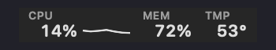
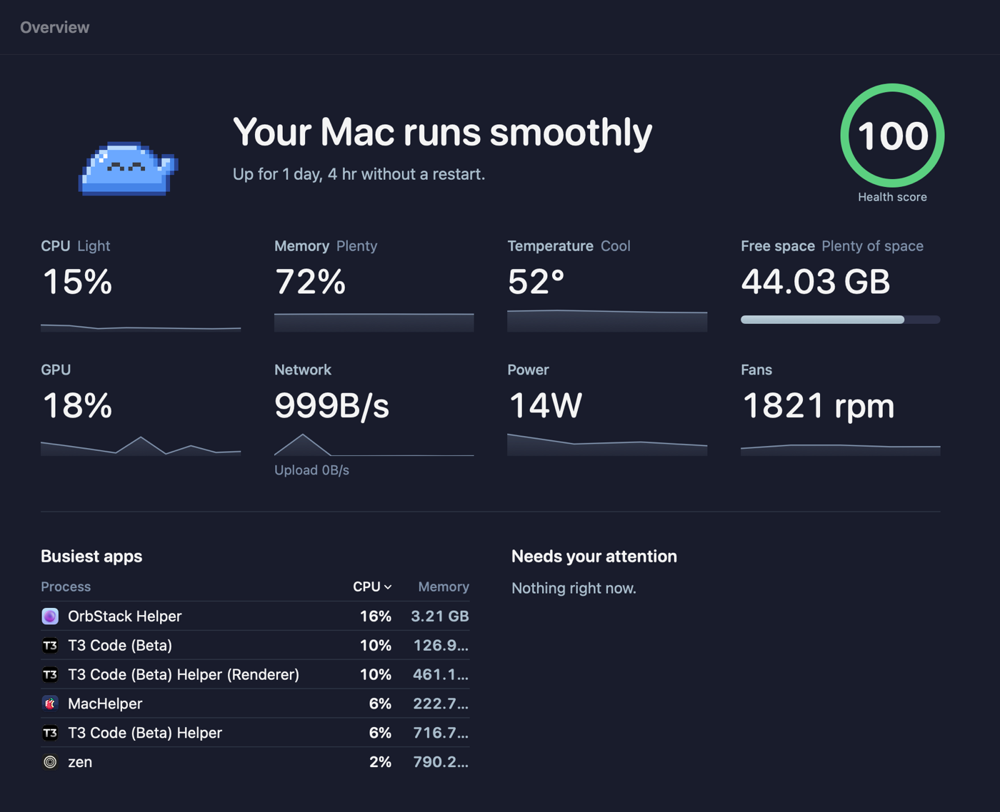
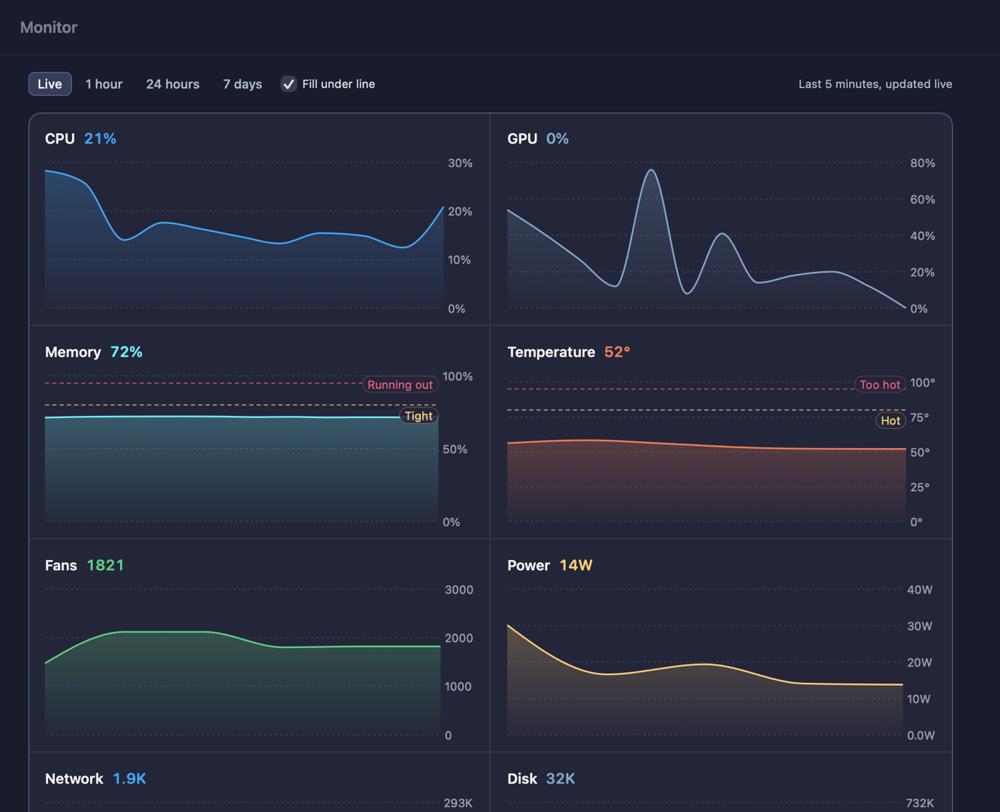
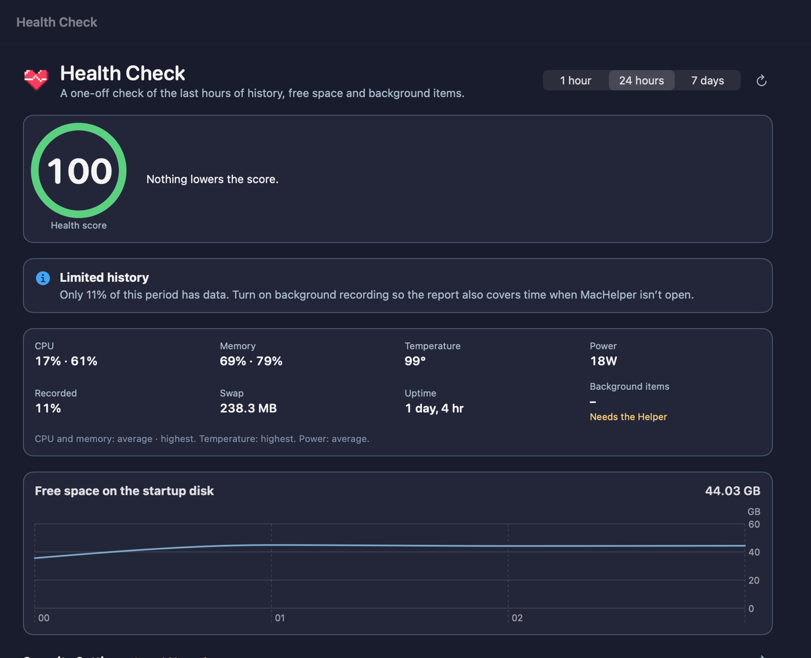
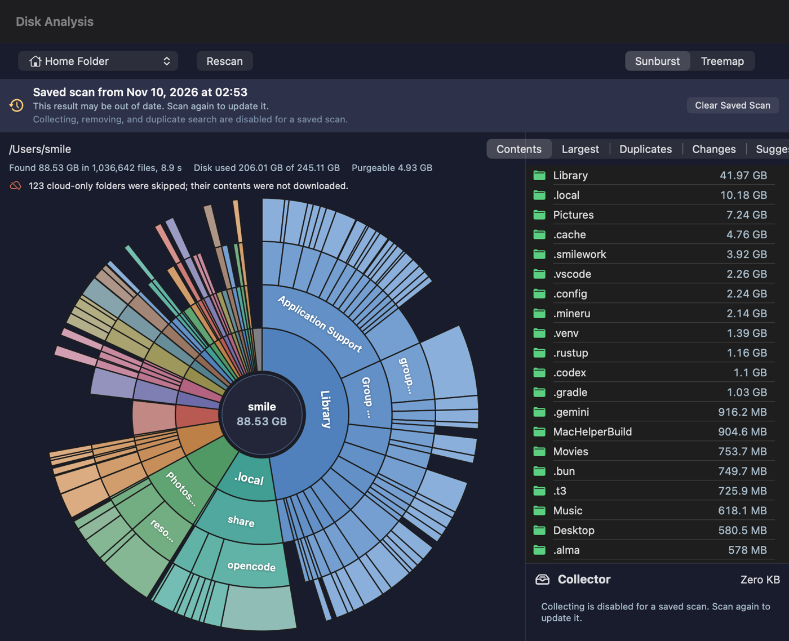

<p align="center">
  
</p>

<h1 align="center">MacHelper</h1>

<p align="center">
  <b>A fully local Mac utility: system monitor, fan control, cleanup and disk analysis in one menu bar app.</b>
</p>

<p align="center">
  <a href="https://github.com/smile-minecraft/MacHelper/releases/latest"></a>
  
  
  <a href="LICENSE"></a>
</p>

<p align="center">
  English · <a href="README.zh-Hant.md">繁體中文</a> · <a href="README.zh-Hans.md">简体中文</a> · <a href="README.ja.md">日本語</a> · <a href="README.ko.md">한국어</a> · <a href="README.es.md">Español</a>
</p>

<p align="center">
  
</p>

<p align="center">
  
</p>

<p align="center">
  <a href="#install"><b>Install</b></a> ·
  <a href="#features"><b>Features</b></a> ·
  <a href="#first-launch"><b>First launch</b></a> ·
  <a href="#command-line"><b>Command line</b></a> ·
  <a href="#building"><b>Building</b></a> ·
  <a href="#releasing"><b>Releasing</b></a>
</p>

---

Everything MacHelper measures and stores stays on your Mac: no accounts, no analytics, no network calls
except the update check. It needs macOS 14 or later on an Apple Silicon Mac and is MIT licensed.

## Install

```sh
brew install --cask smile-minecraft/tap/machelper
```

Or download `MacHelper-<version>.dmg` from [Releases](https://github.com/smile-minecraft/MacHelper/releases/latest)
and drag MacHelper to Applications. Releases are signed with a Developer ID and notarized by Apple, so the
app opens like any other. Checksums are in `SHA256SUMS.txt` on each release page.

MacHelper keeps itself up to date: it checks in the background, shows an **Update to x.y.z** button in the
sidebar, the menu bar panel and Settings, and installs only when you click it. The update window shows
what's new in the language the app runs in.

## Features

<table>
  <tr>
    <td width="50%" valign="top">
      <h3>Monitor</h3>
      
      <p>CPU (performance and efficiency cores), GPU, memory pressure, temperatures, fans, power, battery,
      disk and network throughput. Live charts and per-minute history for 1 hour, 24 hours or 7 days, with
      warning lines for memory and heat. Each menu bar item can be text, sparkline, columns, bar, ring,
      blocks, a heat pill or dual lines.</p>
    </td>
    <td width="50%" valign="top">
      <h3>Health check</h3>
      
      <p>A health score from the last hours of history, free space and background items, with what lowers
      it and what to do. Read-only security check of Gatekeeper, FileVault, the firewall, SIP, automatic
      security updates and XProtect.</p>
    </td>
  </tr>
  <tr>
    <td colspan="2" valign="top">
      <h3>Disk analysis</h3>
      
      <p>Sunburst and treemap (click any folder to jump straight into it), the largest files with kind and
      age filters, duplicates (APFS clones and hard links understood), what changed since the last scan, and
      space suggestions for big unused files and bloated folders. Drag items to the collector and move them
      to the Trash in one go.</p>
    </td>
  </tr>
</table>

| | |
|---|---|
| **Fan control** | Automatic, fixed speed or temperature curves (quiet, balanced, performance, custom), an “only increase” mode, hard safety limits, and profiles that switch by running app or power source. |
| **One-click optimize** | Declarative cleaning rules with a preview: low-risk caches are deleted, medium and high risk go to the Trash. Protected paths, a never-clean list, an operation log, maintenance tasks, project build-artifact cleanup and scheduled auto-clean. |
| **App uninstaller** | Finds what an app left behind from bundle IDs, embedded helpers, entitlements, container metadata, launchd ownership, Homebrew zap lists and per-app rules. Name-only matches are flagged for review; leftovers of apps already gone are found too. |
| **Startup items** | Your launch agents (disable, enable, remove), all-users agents and system daemons, with the owning app and broken items marked. |
| **Homebrew updates** | Updates apps you installed with Homebrew. |
| **Alerts** | Notifications for high CPU temperature, critical memory pressure and low disk space. |
| **Optional history** | Process, sensor and core history are off by default. Process history keeps only the name, CPU and memory (no paths, arguments or user names). Retention is 1–30 days. |
| **The slime** | The mascot follows how the Mac is doing (blue, yellow, red), reacts to taps, hovering and dragging, and to events like heat or a finished cleanup. Reduce Motion and VoiceOver are respected. |
| **Languages** | English, Traditional Chinese, Simplified Chinese, Japanese, Korean and Spanish. Settings → General → Language overrides the system language. |

## First launch

MacHelper walks you through two permissions, one at a time. Both are optional; everything else works
without them.

1. **Full Disk Access** lets disk analysis and cleanup see protected places such as Mail downloads and
   other apps' caches. Turn MacHelper on in **System Settings → Privacy & Security → Full Disk Access**;
   the sheet notices by itself. Folders under System Integrity Protection stay unreadable even then, and
   disk analysis lists them separately.
2. **The Helper** is a small root daemon for fan control, system cache and log cleanup, system background
   items and system process usage. The guide installs it, opens **System Settings → General → Login Items
   & Extensions** for you to allow it, and confirms it answers. It verifies the code signature of every
   caller. While it is off, **Set up Helper…** at the bottom of the sidebar opens the guide again.

## Command line

The app bundles `machelper` (Homebrew links it for you). Every command previews by default and supports
`--json`, so it works well in scripts and for AI agents. Run `machelper guide` for an overview and
`machelper <command> --help` for each command.

```sh
machelper status --json                 # every reading right now
machelper clean                         # preview what would be cleaned
machelper clean --max-risk low --yes    # clean only the low-risk items
```

## Building

Requirements: Xcode 16 or later and [XcodeGen](https://github.com/yonaskolb/XcodeGen).

```sh
xcodegen generate
scripts/install.sh          # Release build → /Applications/MacHelper.app, then relaunch
swift test                  # unit tests for the Swift packages
```

`Config/Signing.xcconfig` signs ad-hoc by default. For a Helper registration that survives rebuilds,
create a git-ignored `Config/Local.xcconfig` with your team (a free Apple ID's Personal Team works):

```
DEVELOPMENT_TEAM = XXXXXXXXXX
CODE_SIGN_STYLE = Automatic
CODE_SIGN_IDENTITY = Apple Development
```

| Path | |
|---|---|
| `App/` | The SwiftUI/AppKit menu bar app |
| `Helper/` | Root helper daemon (fan writes, root-only maintenance) |
| `Sources/SMCKit`, `Metrics`, `FanControl` | Hardware access, sampling, fan curves and policies |
| `Sources/DiskScan` | Fast `getattrlistbulk` scanner, chart layouts, duplicates, scan snapshots |
| `Sources/CleanEngine` | Cleaning rules, safety checks, uninstaller, startup items, auto-clean |
| `Sources/Storage` | Metric history (GRDB) |
| `Sources/machelper` | The CLI |
| `docs/release-notes/` | Translated release notes shown in the update window |

The README images are made from the app itself: `MacHelper --snapshot-window DIR --dark` renders every page,
`--snapshot DIR` the menu bar, and `--export-mascot-gif FILE` the slime animation.

## Releasing

1. Move the changes under **Unreleased** in [CHANGELOG.md](CHANGELOG.md) to a new `## [x.y.z]` section.
   It becomes the GitHub release notes and the English notes in the update window.
2. Translate that section into `docs/release-notes/x.y.z/<lang>.md` for `zh-Hant`, `zh-Hans`, `ja`, `ko`
   and `es`. Preparing a release fails while any of them is missing.
3. `scripts/release.sh build x.y.z` — a trial run: tests, a clean Release build, the DMG and zip.
4. `SPARKLE_APPCAST=1 scripts/release.sh prepare x.y.z` — tests, a Developer ID build, notarization, then
   commits the version, tags `vx.y.z` and writes the Sparkle appcast with one release-notes link per language.
5. `scripts/release.sh publish x.y.z` — pushes `main` and the tag, creates the GitHub release, updates the
   [Homebrew tap](https://github.com/smile-minecraft/homebrew-tap) and finally publishes the appcast to
   GitHub Pages, which is when installed copies see the update.

CI (`.github/workflows/ci.yml`) runs the tests and an ad-hoc signed build on every push and pull request.

## Translating

Source strings are English. Translations live in String Catalogs: `App/Resources/Localizable.xcstrings`,
`Sources/CleanEngine/Localizable.xcstrings` and `Sources/CleanEngine/Rules.xcstrings` (rule text, keyed
`rule.<id>.title`). Open them in Xcode and add a language, or use `scripts/l10n/add.py --lang ja`. After a
build, `scripts/l10n/check.py` lists strings missing in any shipped language. A new language also goes into
`AppLanguage.all` (`App/Main/AppLanguage.swift`), `NOTE_LANGS` in `scripts/sparkle/appcast.sh`, and gets a
README.

## License

MIT — see [LICENSE](LICENSE).
