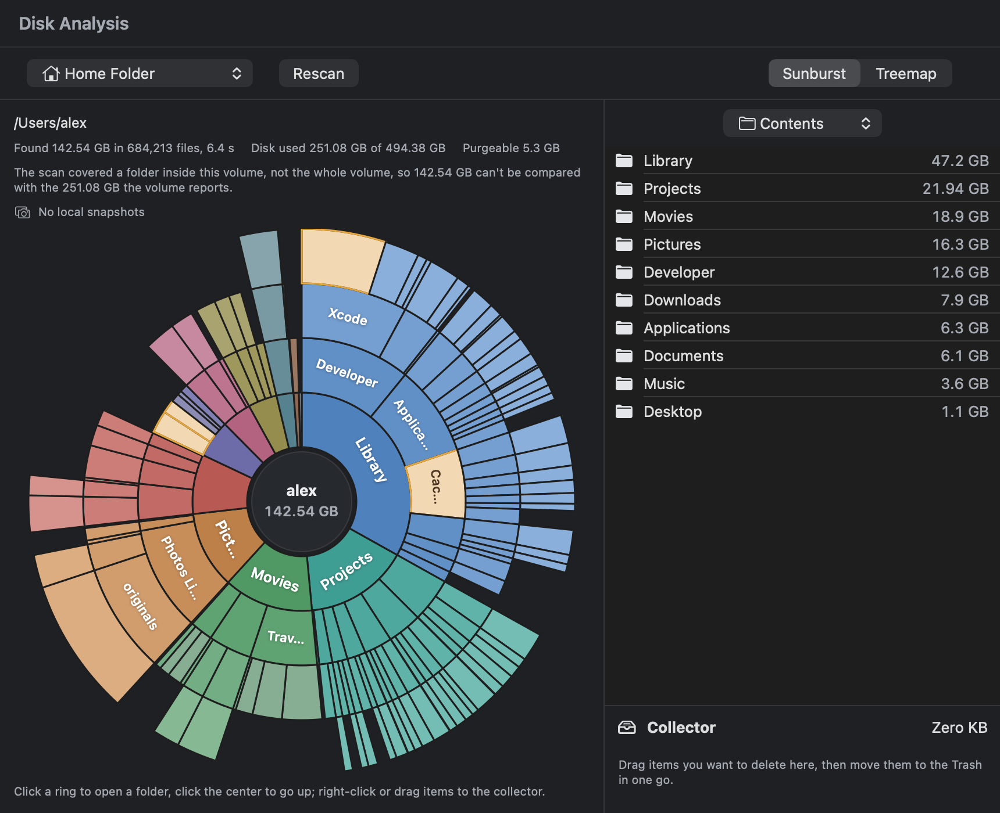

<p align="center">
  
</p>

<h1 align="center">MacHelper</h1>

<p align="center">
  <b>专为 Apple Silicon 打造的原生 macOS 系统监控、风扇控制、清理、磁盘分析与 AI 就绪 CLI 工具——本地优先、完全开源。</b>
</p>

<p align="center">
  <a href="https://github.com/smile-minecraft/MacHelper/releases/latest"></a>
  
  
  <a href="LICENSE"></a>
  <a href="https://smile-minecraft.github.io/MacHelper/"></a>
</p>

<p align="center">
  <a href="README.md">English</a> ·
  <a href="README.zh-Hant.md">繁體中文</a> ·
  <b>简体中文</b> ·
  <a href="README.ja.md">日本語</a> ·
  <a href="README.ko.md">한국어</a> ·
  <a href="README.es.md">Español</a>
</p>

<p align="center">
  <a href="#为什么选择-machelper">为什么选择 MacHelper</a> ·
  <a href="#安装">安装</a> ·
  <a href="#功能">功能</a> ·
  <a href="#隐私与遥测">隐私</a> ·
  <a href="#首次打开">首次打开</a> ·
  <a href="#命令行">CLI</a> ·
  <a href="#搭配-ai-agent-使用">AI Agent</a> ·
  <a href="#常见问题">常见问题</a> ·
  <a href="#从源代码构建">构建开发</a>
</p>

<p align="center">
  
</p>

<p align="center">
  
</p>

---

MacHelper 是免费、以 MIT 许可证开源的菜单栏 App 与命令行工具，使用原生 Swift 编写，适用于运行 macOS 14 或更高版本的 Apple Silicon Mac。它将**系统监控**（CPU、GPU、内存、温度、风扇、功耗、电池、磁盘与网络）、**风扇控制**、**缓存与垃圾清理**、**磁盘空间分析**以及 **App 卸载**整合在同一个轻量级 App 中。

同时内置支持 `--json` 输出的 `machelper` 命令行工具、一键脱敏诊断报告（`machelper report --json`），以及面向 Claude Code、Codex、OpenCode 等 AI 编程助手的技能——始终先预览再执行，移除任何项目前都会先向你确认。

## 为什么选择 MacHelper

不用同时安装五款付费软件，MacHelper 用一个原生 App 就能覆盖全套系统维护需求：

| 核心能力 | 可替代工具 | MacHelper 的做法 |
|---|---|---|
| **系统与菜单栏监控** | iStat Menus | 原生 SwiftUI/AppKit 传感器读数、性能/能效核心拆分、1 小时/24 小时/7 天历史、8 种菜单栏样式 |
| **风扇转速与曲线** | Macs Fan Control | 固定转速或自定义温度曲线、「只升不降」模式、按运行中 App 或电源自动切换配置 |
| **系统清理与维护** | CleanMyMac | 声明式清理规则、默认仅预览不删除、中高风险移入废纸篓、严格受保护路径 |
| **磁盘空间分析** | DaisyDisk | 高速 `getattrlistbulk` 旭日图与矩形树状图、识别 APFS 克隆的重复检测、空间增长追踪 |
| **App 彻底卸载** | AppCleaner | 追踪 Bundle ID、内置 Helper、容器、launchd 与 Homebrew zap 规则，支持孤儿残留清理 |
| **AI Agent 自动化** | *MacHelper 独有* | `machelper report --json` 脱敏诊断报告、`--yes` 安全确认门控、内置 Agent 技能 |

> **免费 · 开源（MIT）· 原生 Swift · Apple Silicon · 默认本地优先**

## 安装

```sh
brew install --cask smile-minecraft/tap/machelper
```

也可以从 [Releases](https://github.com/smile-minecraft/MacHelper/releases/latest) 下载 `MacHelper-<版本>.dmg`，并将 **MacHelper** 拖入「应用程序」。每个正式版本均使用 Developer ID 签名并通过 Apple 公证，可直接打开；校验值公布在各发布页的 `SHA256SUMS.txt` 中。你也可以访问 [MacHelper 官方网站](https://smile-minecraft.github.io/MacHelper/) 查看功能概览与版本亮点。

**自动更新：** MacHelper 会在后台检查新版本，并在侧边栏、菜单栏面板和设置中显示 **更新到 x.y.z** 按钮——在你点击前不会安装任何更新。更新窗口会以你选定的 App 语言显示更新日志。

## 功能

<table>
  <tr>
    <td width="50%" valign="top">
      <h3>系统监控</h3>
      
      <p>提供 CPU（性能核心与能效核心）、GPU、内存压力、温度、风扇、功耗、电池、磁盘与网络吞吐量的实时图表与每分钟历史（1 小时、24 小时或 7 天），并在内存和温度图表中标注警戒线。菜单栏的每一项均可自定义为文本、折线、柱状、条形、圆环、方块、热度胶囊或双线。</p>
    </td>
    <td width="50%" valign="top">
      <h3>健康检查</h3>
      
      <p>依据最近数小时的系统历史、可用空间与后台项目计算健康分数，清楚说明扣分原因与改进建议。同时只读检查 Gatekeeper、FileVault、防火墙、系统完整性保护（SIP）、自动安全更新与 XProtect 状态。</p>
    </td>
  </tr>
  <tr>
    <td colspan="2" valign="top">
      <h3>磁盘分析</h3>
      
      <p>交互式旭日图与矩形树状图（点按任意文件夹即可深入查看）、支持类型与时间筛选的最大文件列表、重复文件检测（准确识别 APFS 克隆与硬链接）、跨次扫描容量变化对比，以及针对长期未用大文件和异常膨胀文件夹的空间建议。将项目拖入收集篮，即可一次移入废纸篓。</p>
    </td>
  </tr>
</table>

| 功能领域 | 亮点说明 |
|---|---|
| **风扇控制** | 支持自动、固定转速或温度曲线（安静、平衡、性能、自定义）、「只升不降」模式、硬性安全上限，并可根据当前运行的 App 或电源自动切换配置。 |
| **一键优化** | 声明式清理规则搭配预览：低风险缓存直接删除，中高风险项目移入废纸篓。内置受保护路径、永不清理列表、操作记录、维护任务、项目构建产物清理与定时自动清理。 |
| **App 卸载** | 通过 Bundle ID、内置 Helper、权限、容器信息、`launchd` 所有者、Homebrew zap 列表及各 App 规则定位残留文件。仅靠名称匹配的项目会标出供复核，也可扫描已删除 App 的遗留文件。 |
| **启动项目** | 管理你的用户 Launch Agent（停用、启用、移除），并查看所有用户 Agent 与系统 Daemon，清晰标记所属 App 与失效项目。 |
| **Homebrew 更新** | 直接在 MacHelper 内查看并更新通过 Homebrew 安装的 App 与 Cask。 |
| **告警通知** | CPU 温度过高、内存压力危急或磁盘空间不足时及时提醒。 |
| **可选的历史记录** | 进程、传感器与核心历史默认关闭。进程历史仅保留名称、CPU 与内存（不记录路径、参数或用户名），保留时长可设为 1–30 天。 |
| **史莱姆吉祥物** | 跟随 Mac 状态变换颜色（蓝、黄、红），响应点按、悬停、拖动及过热、清理完成等事件，并支持「减弱动态效果」与 VoiceOver。 |
| **主题与材质** | 支持浅色、深色或跟随系统模式；纯色（Solid）、磨砂（Frosted）或液态玻璃（Liquid Glass）表面材质；Instrument 与像素复古（Pixel Retro）预设；支持导入 VS Code 主题，并经过对比度校验确保可读性。 |
| **多语言** | 支持英文、繁体中文、简体中文、日文、韩文与西班牙文，可在 **设置 → 通用 → 语言** 中独立于系统语言指定。 |

## 隐私与遥测

- **默认本地优先（Local-first）。** MacHelper 测量、扫描和保存的所有数据都留在你的 Mac 上，无需账号、没有云端同步，也没有任何后台追踪。除检查更新外，除非你主动开启，否则不会发起任何网络请求。
- **可选遥测（默认关闭）。** 你可以在 **设置 → 通用 → 隐私与诊断** 中自主选择加入，仅分享严格匿名的功能使用次数与粗粒度性能诊断（App 版本、macOS 版本、芯片系列及匿名计数）。
- **零敏感数据。** 绝不采集任何文件路径、进程名称、磁盘内容、主机名或个人身份标识。开启后可在设置中直接预览完整的 JSON 数据载荷，也能随时关闭——关闭后会立即清除匿名标识符和待发送队列。

## 首次打开

MacHelper 会打开包含 6 个步骤的 **欢迎指南**（之后也可随时通过 **帮助 → 欢迎指南…** 重新播放），引导你完成偏好设置、可选的 **完全磁盘访问权限**、**Helper** 以及 **AI Agent 技能** 配置。不开启可选权限也能正常使用其他所有功能：

1. **完全磁盘访问权限**让磁盘分析与清理能读取受保护的位置，例如「邮件」下载项和其他 App 的缓存。请在 **系统设置 → 隐私与安全性 → 完全磁盘访问权限** 中开启 MacHelper，欢迎指南会自动检测状态。受系统完整性保护（SIP）的文件夹即便开启也无法读取，磁盘分析会单独列出。
2. **Helper** 是一个轻量的 root 后台守护进程，负责风扇控制、系统缓存与日志清理、系统后台项以及系统进程用量。指南会帮你安装、打开 **系统设置 → 通用 → 登录项与扩展** 供你批准，并验证其响应状态。它会校验每个调用方的代码签名。未启用时，点击侧边栏底部的 **设置 Helper…** 可随时重新打开设置。
3. **AI Agent 技能** 可直接在指南中为检测到的代理（如 Claude Code 与 Codex）安装技能，且不会覆盖已有的自定义 `SKILL.md` 文件。

## 命令行

MacHelper 内置 `machelper` CLI（通过 Homebrew 安装时会自动链接）。所有命令默认仅预览且支持 `--json`，非常适合脚本与 AI Agent 调用。运行 `machelper guide` 查看总览，运行 `machelper <命令> --help` 查看各命令参数。

```sh
machelper report --json                 # 脱敏的完整系统诊断报告
machelper status --json                 # 实时硬件、温度、风扇与电池快照
machelper clean                         # 预览将会清理的项目
machelper clean --max-risk low --yes    # 仅清理低风险项目
```

## 搭配 AI Agent 使用

当你请 AI 助手（Claude Code、Codex、OpenCode 等）排查 Mac 变慢或发热原因、释放磁盘空间、清理 `node_modules` 或 Xcode 残留、彻底卸载 App，或审查启动项时，`machelper` 为其提供了安全、结构化的操作接口。

- **单次输出脱敏诊断报告（`machelper report`）。** 运行 `machelper report --json`（或 `machelper report --format markdown`）即可一次生成涵盖硬件规格、实时指标、健康评分、存储占用、安全审计、清理预览和启动项的完整诊断报告。默认会自动抹除用户名、主目录路径、主机名、IP 与 MAC 地址，且 JSON 输出附带结构化的 `suggestedActions` 与 `availableTools`，方便 AI Agent 安全衔接后续 `machelper` 命令。
- **默认安全。** 所有修改类命令默认仅预览，直到显式传入 `--yes` 才会执行。移除项目默认进入废纸篓（除非传入 `--permanent`），受保护路径（钥匙串、邮件、照片、`~/.ssh`、`~/Documents` 等）永远无法删除。
- **机器可读。** 各命令均支持 `--json`，提供稳定的 `schemaVersion` 字段与可预测的退出码，还可通过 `machelper --experimental-dump-help` 导出完整 JSON 命令树。
- **内置 Agent 技能。** 运行 `machelper skill install claude` 或 `machelper skill install codex`（也可在设置中安装）会安装 `SKILL.md`，要求 Agent 先查看／预览，并在应用更改前征得用户确认。

```sh
brew install --cask smile-minecraft/tap/machelper
machelper guide                          # Agent 应首先阅读的指南
machelper report --json                  # 完整脱敏诊断报告 + suggestedActions
machelper insights ~ --json              # 长期未用的大文件与膨胀文件夹
machelper clean --json                   # 预览清理；加上 --yes 前先询问用户
```

面向语言模型的索引文件位于 [llms.txt](llms.txt)。

## 常见问题

**有没有免费开源、可替代 CleanMyMac 或 iStat Menus 的 App？**
有的。MacHelper 采用 MIT 许可证，在一个原生 App 中集成了系统清理、菜单栏监控、风扇控制、磁盘分析和 App 卸载，无需账号或订阅。

**如何控制 Apple Silicon Mac 的风扇转速？**
安装 MacHelper 并配置 Helper（首次启动会有引导）。之后可以让风扇自动运行、保持固定转速，或按自定义温度曲线运行，具备硬性安全上限，还能根据当前 App 或电源自动切换配置。

**如何给 AI 助手生成一份不泄露个人隐私的系统诊断报告？**
运行 `machelper report --json`（或 `--format markdown`）。它能一次性收集硬件、指标、健康评分、存储、安全检查、清理预览和启动项，并默认脱敏用户名、路径、主机名、IP 与 MAC 地址。

**如何在终端释放 Mac 磁盘空间？**
通过 `brew install --cask smile-minecraft/tap/machelper` 安装后，用 `machelper clean` 预览、`machelper clean --max-risk low --yes` 清理低风险缓存；用 `machelper insights ~` 查找长期未用的大文件和膨胀文件夹；用 `machelper purge --path ~/Developer` 移除 `node_modules`、`target`、`.build` 等构建目录。

**如何把 Mac App 连同残留文件一起彻底卸载？**
运行 `machelper uninstall "App 名称"` 预览偏好设置、缓存、容器、启动项和 Homebrew zap 匹配项，加上 `--yes` 即可移入废纸篓。运行 `machelper uninstall --orphans` 可查找已删除 App 的遗留文件。

**支持 Intel Mac 或更早的 macOS 吗？**
不支持。MacHelper 仅支持运行 macOS 14 或更高版本的 Apple Silicon Mac。

**MacHelper 会收集什么数据？**
默认情况下，除检查更新外不会有任何数据离开你的 Mac。如果你在 **设置 → 通用 → 隐私与诊断** 中主动开启遥测，MacHelper 仅会发送严格匿名的使用计数与粗粒度性能诊断（App 版本、macOS 版本、芯片系列），不包含任何文件路径、进程名或个人身份信息，你可以随时查看精确的 JSON 内容并关闭。

## 从源代码构建

环境要求：Apple Silicon Mac、Xcode 26 或更高版本，以及 [XcodeGen](https://github.com/yonaskolb/XcodeGen)（`brew install xcodegen`）。运行 `make` 可列出所有可用目标。

```sh
make setup      # 检查工具、下载 Sparkle、生成 MacHelper.xcodeproj
make open       # 在 Xcode 中打开项目，按 ⌘R 构建并运行
make run        # 或构建 Debug 版本到 build/ 并打开
make test       # 运行 Swift 包单元测试
make install    # Release 构建 → /Applications/MacHelper.app 并重启
```

日常开发构建输出在 `build/` 下，不会修改 `/Applications`。从 `build/` 运行前请先退出已安装的 MacHelper，两者共用同一份设置与数据。调试 root Helper 改动（风扇控制、系统清理）使用 `make install` 最方便。增删源文件后请运行 `make project`；在没有电池的桌面 Mac 上可通过 `make run ARGS=--demo-battery` 模拟电池读数。

**性能剖析工具：** MacHelper 在磁盘扫描、传感器采样与 UI 热点路径均内置 Apple 原生 `OSSignposter` 插桩，开发时可使用 `scripts/perf/xctrace-profile.sh` 直接从命令行采集 Instruments 跟踪数据。

<details>
<summary><b>开发者参考：本地签名配置、仓库结构、截图导出、发布与翻译</b></summary>

本地覆盖配置（`Config/Local.env`、`Config/Local.xcconfig`）、完整目录结构、README 截图与史莱姆 GIF 导出参数、发布流程（含多语言更新说明）以及 String Catalog 翻译指南，请参阅[英文 README](README.md#building)。

</details>

## 许可证

MIT — 详见 [LICENSE](LICENSE)。
